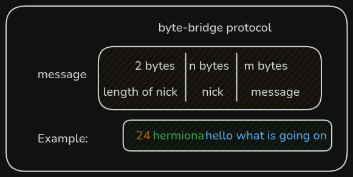
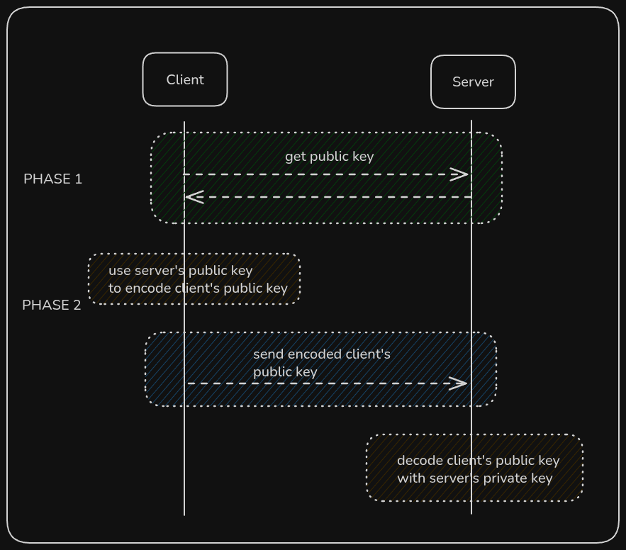

# Byte-bridge: Custom TCP protocol

A simple TCP-based protocol to experiment with designing my own application-layer communication protocol (in a very simplified way).

For now it's just custom bytes send by tcp, with custom parsing.
The idea is that we send lenght of the nickname in first 2 bytes (0 < n < 99).
Then the nick itself. Then the message.
The idea is showed below

</img>
 

Next steps is going full encryption with pairs of public/private keys as showed below.

</img>

Not finished :'(

# TODO
- [ ] public/private key exchange
- [ ] actually use encryption
- [ ] display messages on clients (really? :D)
- [ ] terraform with whole infra as a code (it's just EC2 with small 1 program in python)
- [ ] multiple clients - basically multithreading, but as simple as possible
- [ ] stress testing - how many clients can that simple server on ec2 (large) can handle?
